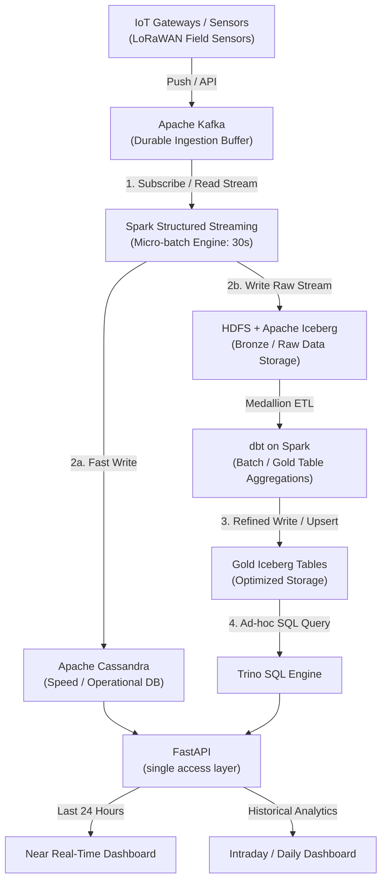

# Agricultural Monitoring Data Platform

A Docker-hosted data engineering solution for multi-farm agricultural monitoring. Field sensors stream data into a lakehouse, and two dashboards serve it: a **near real-time** one for current conditions and alerts, and an **intraday / daily** one for trends, comparisons and history.

This is a group project for the data engineering course. The brief asks for a system in one application domain (ours is **agriculture**) that shows the data engineering solution works, covering domain data, data engineering for the business requirements, and an application that delivers the results. We also evaluate the chosen technologies.

## Business requirements

The platform covers **8 business requirements**. See [`REQUIREMENTS.md`](REQUIREMENTS.md) for functional requirements and acceptance criteria.

| ID | Requirement |
|---|---|
| BR1 | Centralize agricultural monitoring |
| BR2 | Improve awareness of field conditions |
| BR3 | Maintain monitoring continuity |
| BR4 | Establish trustworthy agricultural data |
| BR5 | Support data-driven farm management |
| BR6 | Enable historical evaluation and planning |
| BR7 | Make agricultural insights accessible |
| BR8 | Support early response to agricultural risks |

Users: farm managers, farm operators, analysts, and the internal data team.

## Architecture



**Two serving paths**

| | Near real-time | Intraday / daily |
|---|---|---|
| Path | FastAPI → Cassandra | FastAPI → Trino → gold Iceberg |
| Window | Last 24 hours | Hours to full history |
| Content | Current values, active alerts, device status | Trends, field comparisons, seasonal analysis |

## Tech stack

| Layer | Technology |
|---|---|
| Hosting | Docker Compose |
| Ingestion | HTTP ingest service → Apache Kafka (KRaft) |
| Stream processing | Spark Structured Streaming (30 s micro-batch) |
| Batch transformations | dbt (dbt-spark on Spark Thrift Server) |
| Lakehouse | Apache Iceberg on HDFS (bronze / silver / gold), Hive Metastore catalog |
| Operational store | Apache Cassandra |
| Query engine | Trino |
| API | FastAPI |
| Web app | Dashboards (frontend framework to be decided) |
| Task runner | just |
| Python packages | uv |

There is no Airflow, Prometheus or Grafana. Batch jobs are `just` recipes triggered by a lightweight scheduler (cron in a container), and health is tracked through logs plus the data-quality and device-status tables.

## How it works

1. **Ingest:** simulated LoRaWAN sensors push readings to an ingest service that publishes to Kafka, which buffers events durably.
2. **Stream:** Spark validates each micro-batch, de-duplicates, detects alert conditions and device outages, then writes to two places: Cassandra (fast, last 24 h) and Iceberg bronze (raw, full history).
3. **Batch:** dbt models, executed on Spark, build silver (clean, de-duplicated) and gold (hourly/daily aggregates, indicators, quality summaries) tables and test them. A maintenance macro compacts small Iceberg files.
4. **Serve:** FastAPI reads Cassandra for live views and Trino for analytical views. The web app only talks to FastAPI.

## Quick start

The local development stack runs through Docker Compose. Use the `justfile` as
the entry point rather than invoking individual containers directly.

### Prerequisites

- Docker Desktop, OrbStack, or another Docker Engine that supports Docker
  Compose profiles
- [`just`](https://github.com/casey/just)
- [`uv`](https://docs.astral.sh/uv/) for local Python tooling and tests
- At least 8 GB of memory available to Docker is recommended for HDFS,
  Cassandra, Spark, Trino and the Hive Metastore

Check the installation and make sure the Docker daemon is running:

```bash
just init              # create .env from .env.example if it does not exist
uv sync                # install local Python dependencies
just doctor
```

`just init` never overwrites an existing `.env`. Adjust `.env` only for local
resource limits, ports, or simulator settings; do not commit it.

### Start the platform

For a complete local run, start the profiles in this order:

```bash
just up-core           # HDFS, Kafka, Hive Metastore, Trino and ingest
just up-serving        # Cassandra and FastAPI
just up-processing     # build Spark, dbt, test and simulator images
just lakehouse-init    # create Iceberg namespaces and streaming tables
```

`just up` is a convenience command that starts the core and serving profiles
and builds the processing images. The explicit commands above make it easier
to identify which stage failed.

Check the running services with:

```bash
just ps
just ingest-check
just hdfs-warehouse
```

API documentation is available at <http://localhost:8000/docs>. Other useful
local endpoints are the Trino UI at <http://localhost:8080> and the HDFS
NameNode UI at <http://localhost:9870>.

### Run the streaming demo

Start Spark in the background, then send simulated readings through the normal
HTTP ingest path:

```bash
just run-stream-bg          # default: 30-second micro-batches
just sim-for 60             # send readings for 60 seconds
just verify-pipeline        # query Cassandra and bronze Iceberg outputs
```

For a faster development loop, override the trigger and maximum Kafka records
per batch with positional arguments:

```bash
just run-stream-bg 10s 20000
just sim-for 30
```

The stream writes near real-time results to Cassandra and raw, validated
records to HDFS/Iceberg. `just verify-pipeline` reports counts from both sink
families, including quarantined records and quality flags.

To follow the Spark logs or stop the stream:

```bash
just logs spark-stream
just stop-stream
```

The simulator injects faults by default. This is intentional: malformed,
unknown or out-of-range readings should be visible in the quarantine and
quality-count tables rather than stopping the streaming job.

### Batch models and tests

After bronze data exists, build and test the dbt models:

```bash
just dbt-run
just dbt-test
just compact bronze.sensor_readings
```

Run the pure-Python unit tests without the platform stack:

```bash
just test-unit
```

The containerised integration tests use the running stack:

```bash
just test
```

### Stop or reset the stack

```bash
just down                # stop containers; preserve volumes and data
just clean               # stop containers and delete all Compose volumes
```

`just clean` is destructive. To replay Kafka data while preserving the
lakehouse, remove only the Spark checkpoints:

```bash
just streaming-reset
```

To inspect or reset Kafka:

```bash
just kafka-topics
just kafka-tail 10
just kafka-reset         # deletes and recreates the sensor topic
```

After resetting Kafka or checkpoints, restart the stream before sending new
simulator data.

### Common startup issues

- **Docker socket or daemon error:** start Docker Desktop or OrbStack, then
  rerun `just doctor`.
- **Missing `.env`:** run `just init`.
- **Build permission prompt:** grant the Docker application filesystem access
  to this repository, or approve the requested path in the Docker runtime.
- **Stream cannot connect to Cassandra:** use `just run-stream-bg`, which
  enables the core, processing and serving profiles and waits for the
  Cassandra schema initializer.
- **No rows in verification:** confirm that `spark-stream` is running with
  `just ps`, send data with `just sim-for 60`, and allow at least one
  micro-batch to complete.

## Planned API (examples)

| Endpoint | Source | Purpose |
|---|---|---|
| `GET /farms` · `/farms/{id}/fields` | Cassandra | Farm, field and device overview (BR1) |
| `GET /fields/{id}/latest` | Cassandra | Current conditions (BR2) |
| `GET /fields/{id}/series?hours=24` | Cassandra | Last-24-hours series (BR2) |
| `GET /devices/{id}/status` | Cassandra | Device health and gaps (BR3, BR8) |
| `GET /quality/summary` | Trino | Data-quality summary (BR4) |
| `GET /fields/{id}/indicators` | Trino | Time-in-range, irrigation indicators (BR5) |
| `GET /fields/{id}/history` | Trino | Period comparisons (BR6) |
| `GET /summary` · `/compare` | Trino | Summaries and field comparisons (BR7) |
| `GET /alerts` · `PATCH /alerts/{id}` | Cassandra | Active alerts, acknowledge and resolve (BR8) |

## Evaluation and benchmarks

1. Micro-batch trigger interval: 10 s / 30 s / 60 s
2. Cassandra vs Trino-on-Iceberg for the same dashboard query
3. Iceberg vs plain Hive/Parquet
4. Effect of compaction on query time
5. Recovery and replay tests

Scripts and results go in `benchmarks/`.

## Repository layout

```
src/         dbt/   cassandra/   web/   benchmarks/   docs/   justfile   pyproject.toml
```

All Python packages live under the unified [`src/`](src/) directory:
`src/api`, `src/batch`, `src/common`, `src/ingest`, `src/simulator`, and
`src/streaming`. The Compose services mount this directory at `/app/src` and
use it as their Python path.

See [`AGENTS.md`](AGENTS.md) for conventions and rules for contributors and coding agents.
