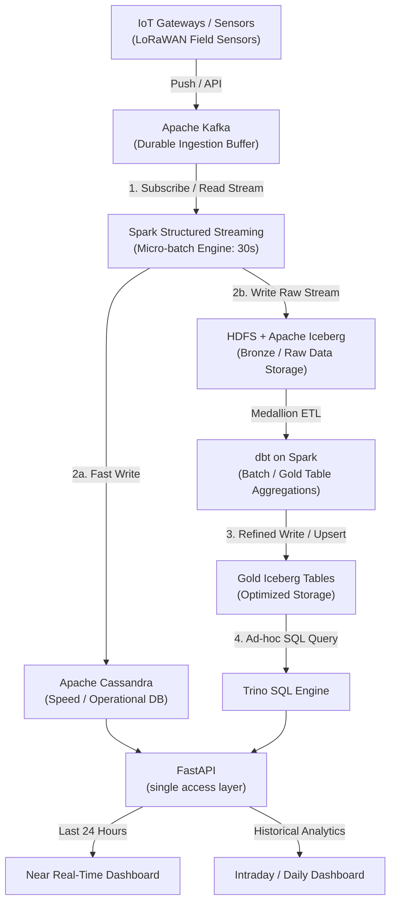

# Agricultural Monitoring Data Platform

A Docker-hosted data engineering solution for multi-farm agricultural monitoring. Field sensors stream data into a lakehouse, and two dashboards serve it: a **near real-time** one for current conditions and alerts, and an **intraday / daily** one for trends, comparisons and history.

This is a group project for the data engineering course. The brief asks for a system in one application domain (ours is **agriculture**) that shows the data engineering solution works, covering domain data, data engineering for the business requirements, and an application that delivers the results. We also evaluate the chosen technologies.

## Business requirements

The platform covers **8 business requirements**. See [`REQUIREMENTS.md`](REQUIREMENTS.md) for functional requirements and acceptance criteria.

| ID | Requirement |
|---|---|
| BR1 | Centralize agricultural monitoring |
| BR2 | Improve awareness of field conditions |
| BR3 | Maintain monitoring continuity |
| BR4 | Establish trustworthy agricultural data |
| BR5 | Support data-driven farm management |
| BR6 | Enable historical evaluation and planning |
| BR7 | Make agricultural insights accessible |
| BR8 | Support early response to agricultural risks |

Users: farm managers, farm operators, analysts, and the internal data team.

## Architecture



**Two serving paths**

| | Near real-time | Intraday / daily |
|---|---|---|
| Path | FastAPI → Cassandra | FastAPI → Trino → gold Iceberg |
| Window | Last 24 hours | Hours to full history |
| Content | Current values, active alerts, device status | Trends, field comparisons, seasonal analysis |

## Tech stack

| Layer | Technology |
|---|---|
| Hosting | Docker Compose |
| Ingestion | HTTP ingest service → Apache Kafka (KRaft) |
| Stream processing | Spark Structured Streaming (30 s micro-batch) |
| Batch transformations | dbt (dbt-spark on Spark Thrift Server) |
| Lakehouse | Apache Iceberg on HDFS (bronze / silver / gold), Hive Metastore catalog |
| Operational store | Apache Cassandra |
| Query engine | Trino |
| API | FastAPI |
| Web app | Dashboards (frontend framework to be decided) |
| Task runner | just |
| Python packages | uv |

There is no Airflow, Prometheus or Grafana. Batch jobs are `just` recipes triggered by a lightweight scheduler (cron in a container), and health is tracked through logs plus the data-quality and device-status tables.

## How it works

1. **Ingest:** simulated LoRaWAN sensors push readings to an ingest service that publishes to Kafka, which buffers events durably.
2. **Stream:** Spark validates each micro-batch, de-duplicates, detects alert conditions and device outages, then writes to two places: Cassandra (fast, last 24 h) and Iceberg bronze (raw, full history).
3. **Batch:** dbt models, executed on Spark, build silver (clean, de-duplicated) and gold (hourly/daily aggregates, indicators, quality summaries) tables and test them. A maintenance macro compacts small Iceberg files.
4. **Serve:** FastAPI reads Cassandra for live views and Trino for analytical views. The web app only talks to FastAPI.

## Quick start

> Target workflow. The compose file and justfile are still to be created.

Prerequisites: Docker, [`uv`](https://docs.astral.sh/uv/) and [`just`](https://github.com/casey/just).

```bash
cp .env.example .env
uv sync                # install Python dependencies from uv.lock
just --list            # show all recipes
just up-core           # Kafka, HDFS, Hive Metastore, Trino
just up-serving        # Cassandra, FastAPI
just run-simulator     # publish sensor events
just run-stream        # start Spark micro-batch jobs
just dbt-run           # build silver and gold models with dbt
just dbt-test          # run dbt tests
just compact           # compact small Iceberg files
```

API docs once running: `http://localhost:8000/docs`

## Planned API (examples)

| Endpoint | Source | Purpose |
|---|---|---|
| `GET /farms` · `/farms/{id}/fields` | Cassandra | Farm, field and device overview (BR1) |
| `GET /fields/{id}/latest` | Cassandra | Current conditions (BR2) |
| `GET /fields/{id}/series?hours=24` | Cassandra | Last-24-hours series (BR2) |
| `GET /devices/{id}/status` | Cassandra | Device health and gaps (BR3, BR8) |
| `GET /quality/summary` | Trino | Data-quality summary (BR4) |
| `GET /fields/{id}/indicators` | Trino | Time-in-range, irrigation indicators (BR5) |
| `GET /fields/{id}/history` | Trino | Period comparisons (BR6) |
| `GET /summary` · `/compare` | Trino | Summaries and field comparisons (BR7) |
| `GET /alerts` · `PATCH /alerts/{id}` | Cassandra | Active alerts, acknowledge and resolve (BR8) |

## Evaluation and benchmarks

1. Micro-batch trigger interval: 10 s / 30 s / 60 s
2. Cassandra vs Trino-on-Iceberg for the same dashboard query
3. Iceberg vs plain Hive/Parquet
4. Effect of compaction on query time
5. Recovery and replay tests

Scripts and results go in `benchmarks/`.

## Repository layout

```
simulator/   ingest/   streaming/   dbt/   cassandra/   api/   web/   benchmarks/   docs/   justfile   pyproject.toml
```

See [`AGENTS.md`](AGENTS.md) for conventions and rules for contributors and coding agents.