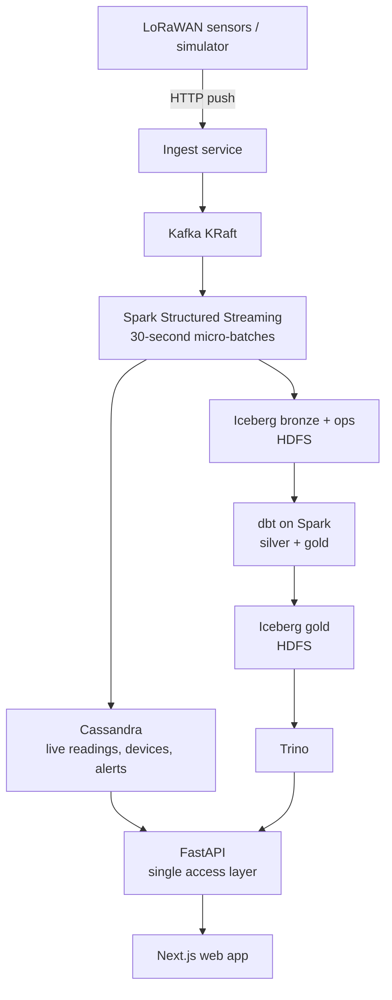

# Agricultural Monitoring Data Platform

An end-to-end agricultural monitoring platform for the data engineering course.
Sensor readings enter through an HTTP ingestion service, are buffered in Kafka,
processed by Spark Structured Streaming, stored in Cassandra for live views and
written to an Iceberg lakehouse for historical analytics.

The project demonstrates eight business requirements. The detailed functional
requirements and acceptance criteria are in [REQUIREMENTS.md](REQUIREMENTS.md).

| ID | Requirement |
|---|---|
| BR1 | Centralize agricultural monitoring |
| BR2 | Improve awareness of field conditions |
| BR3 | Maintain monitoring continuity |
| BR4 | Establish trustworthy agricultural data |
| BR5 | Support data-driven farm management |
| BR6 | Enable historical evaluation and planning |
| BR7 | Make agricultural insights accessible |
| BR8 | Support early response to agricultural risks |

## Architecture



The web browser talks only to Next.js route handlers. Next.js calls FastAPI
server-side, and FastAPI is the only service that accesses Cassandra or Trino.

| Concern | Technology |
|---|---|
| Runtime | Docker Compose profiles |
| Ingestion | HTTP service → Kafka KRaft |
| Streaming | Spark Structured Streaming, 30-second trigger |
| Lakehouse | HDFS + Apache Iceberg |
| Catalog | Hive Metastore backed by Postgres |
| Batch | dbt-spark executed by Spark |
| Live serving | Apache Cassandra |
| Analytical serving | Trino over gold Iceberg |
| API | FastAPI |
| Web | Next.js, TypeScript, Tailwind, Recharts |
| Python tooling | uv |
| Task runner | just |

The project intentionally does not use Airflow, Flink, Prometheus, Grafana,
or direct browser access to infrastructure services.

## Repository layout

```text
.
├── cassandra/              Cassandra schema
├── dbt/                    Silver/gold models, tests, and compaction macros
├── hadoop/                 HDFS configuration and bootstrap scripts
├── images/                 Dockerfiles for Spark, services, and web
├── reference/              Farm, field, device, crop, and metric metadata
├── src/
│   ├── api/                FastAPI live and analytical endpoints
│   ├── batch/              Iceberg namespace/table initialization
│   ├── common/             Shared reference-data loader
│   ├── ingest/             HTTP → Kafka service
│   ├── simulator/          Sensor data and fault simulator
│   └── streaming/          Spark validation, sinks, quality, and alerts
├── web/                    Next.js dashboard
├── docker-compose.yml      Compose profiles and service wiring
├── justfile                Development and operations commands
├── pyproject.toml          Python dependencies and tooling
└── REQUIREMENTS.md         Business and functional requirements
```

## Prerequisites

- Docker Desktop, OrbStack, or another Docker Engine with Compose profiles
- [`just`](https://just.systems/)
- [`uv`](https://docs.astral.sh/uv/) for local Python tooling
- Bun 1.1+ for local web development
- At least 8 GB of memory assigned to Docker; 12 GB is more comfortable for
  HDFS, Kafka, Cassandra, Spark, Trino, and the Hive Metastore together

Initialize the local environment:

```bash
just init
uv sync
just doctor
```

`just init` creates `.env` from `.env.example` and never overwrites it. Keep
credentials and machine-specific settings in `.env`; do not commit it.

## Start the complete dataflow

From the repository root:

```bash
just build
just up
```

`just up` starts the core, serving, and processing profiles. It does not
automatically run the batch models or the simulator.

Initialize the lakehouse and streaming tables:

```bash
just lakehouse-init
```

Start the streaming job:

```bash
just run-stream-bg
```

Send simulated sensor readings:

```bash
just run-simulator
```

For a bounded demo instead:

```bash
just sim-for 120
```

The simulator intentionally injects malformed, late, duplicate, out-of-range,
and outage data. The streaming job should quarantine or flag those records
without crashing.

## Run the batch flow

After the streaming job has written bronze data, run the complete batch path:

```bash
just batch-run
```

This executes:

1. Iceberg namespace and table initialization
2. dbt silver model build
3. dbt gold daily aggregates and indicators
4. dbt data-quality tests
5. Iceberg file compaction

The main analytical tables are:

```text
lakehouse.silver.sensor_readings
lakehouse.gold.field_daily
lakehouse.gold.field_indicators
lakehouse.gold.quality_daily
```

Run individual stages when debugging:

```bash
just dbt-run
just dbt-test
just compact bronze.sensor_readings
just lakehouse-tables
```

The dbt profile is configured for Spark and the Hive-backed Iceberg catalog,
matching the fixed architecture decision. Trino is used for analytical reads
through FastAPI, not as the dbt execution engine.

## Start and use the web app

### Full-stack Docker mode

After `just up`, `just batch-run`, and the streaming job are running:

```bash
just up-app
```

Open the dashboard at <http://localhost:3000>.

The Compose web service uses:

```env
DATA_MODE=api
API_BASE_URL=http://api:8000
```

The browser still communicates only with the Next.js server. FastAPI remains
the only data access layer.

### Local Next.js mode

For frontend-only development:

```bash
cd web
bun install
cp .env.example .env.local
bun run dev
```

Open <http://localhost:3000>. The default `DATA_MODE=mock` provides
deterministic farms, fields, devices, alerts, gaps, quality issues, and
historical chart data without Docker.

To use a reachable FastAPI instance locally, set these values in
`web/.env.local`:

```env
DATA_MODE=api
API_BASE_URL=http://localhost:8000
API_KEY=
```

The web project is independently deployable to Vercel. Set its Vercel Root
Directory to `web`. For preview deployments, use `DATA_MODE=mock`. API mode
requires a public HTTPS FastAPI endpoint; Vercel cannot reach `localhost`.
Deployment details are in [web/README.md](web/README.md).

## API surfaces

FastAPI documentation is available at <http://localhost:8000/docs>.

### Near real-time endpoints

These read Cassandra:

```text
GET  /farms
GET  /farms/{farm_id}/fields
GET  /devices
GET  /devices/{device_id}/status
GET  /fields/{field_id}/latest
GET  /fields/{field_id}/series?metric=soil_moisture&hours=24
GET  /fields/{field_id}/alerts
GET  /alerts?status=open
PATCH /alerts/{alert_id}
```

### Analytical endpoints

These read Trino over dbt-built gold Iceberg tables:

```text
GET /fields/{field_id}/indicators
GET /fields/{field_id}/history
GET /summary
GET /compare
GET /quality/summary
GET /quality/devices
```

If the gold tables have not been built yet, analytical endpoints return a
clear `503` response instructing the operator to run the batch flow.

## Verification and operations

Check service status:

```bash
just ps
just api-health
just ingest-check
```

Verify Cassandra serving tables and bronze/ops Iceberg outputs:

```bash
just verify-pipeline
```

Follow logs:

```bash
just logs api web spark-stream
```

Run Python unit and integration tests:

```bash
just test-unit
just test
```

Run web checks:

```bash
cd web
bun run lint
bun run typecheck
bun run test
bun run build
```

Stop containers while preserving volumes:

```bash
just down
```

Delete containers and all Compose volumes:

```bash
just clean
```

`just clean` is destructive. To replay Kafka data while preserving the other
data, reset only the streaming checkpoint:

```bash
just streaming-reset
```

After a checkpoint reset, restart the stream before sending new simulator data.

## Evaluation benchmarks

The project evaluates:

1. 10-second, 30-second, and 60-second streaming triggers
2. Cassandra versus Trino-on-Iceberg dashboard latency
3. Iceberg versus plain Hive/Parquet
4. Query performance before and after compaction
5. Recovery, replay, no-loss, and no-duplicate behavior

Benchmark configuration must record trigger interval, data volume, hardware,
and relevant service settings. Store scripts and generated results in
`benchmarks/`.

## Troubleshooting

- **Docker is unavailable:** start Docker Desktop or OrbStack, then run
  `just doctor`.
- **`.env` is missing:** run `just init`.
- **No streaming rows:** check `just ps`, `just logs spark-stream`, and send
  data with `just sim-for 60`.
- **No analytical rows:** wait for bronze data, then run `just batch-run`.
- **API is ready but analytics return 503:** Trino or the gold tables are not
  ready; check `just logs api trino` and rerun `just batch-run`.
- **Docker build permission prompt:** grant the container runtime access to the
  repository directory.

See [AGENTS.md](AGENTS.md) for architectural constraints and contribution
conventions.
