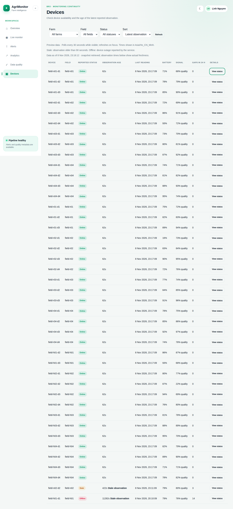
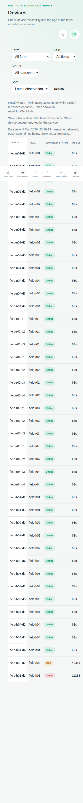

# Devices — M2, BR3

Owner: M2. Branch: `feat/m2-device-continuity`. Only M2 device features,
M2-owned adapters and M2 route handlers are changed. Main's M3 Quality and
Alerts implementations are retained unchanged. Earlier BR4 fixes are preserved
in `backup/br3-br4-before-m2-team-rules` for their owner to review.

## Implemented

- Device table with farm, field and reported-status filters, sorting, last seen,
  observation age, battery, RSSI and gap counts provided by the frozen contract.
- Keyboard-accessible detail drawer (Escape to close, focus returns to trigger).
- TanStack Query: 30-second polling, no polling in hidden tabs, focus refetch,
  independent list/detail queries and one detail request per manual refresh.
- Observation age keeps advancing after request failures; readings older than
  90 seconds carry an explicit stale warning separate from reported status.
- Dates use `NEXT_PUBLIC_TIMEZONE`. Snapshot metadata is labelled "Data as of"
  with a clarification that it is retrieval time, not sensor observation time.
- Mock mode reuses M3's deterministic fixtures and preserves their health/gap
  fields. It is explicitly labelled Preview data.
- Existing mock `rssi` values in 0–1 are displayed as signal-quality percentages,
  not dBm. Negative RSSI values retain dBm; no quality-to-RSSI conversion occurs.
- Loading, empty, error/retry and cached-failure states; responsive table/drawer.

## Data boundary

Browser GET routes: `/api/devices`, `/api/devices/{id}/status`, `/api/farms`,
`/api/farms/{id}/fields`. Only M2-owned `lib/api` calls FastAPI. Payloads use
A5's existing `Envelope<Device>` / `Envelope<Device[]>` and shared schemas.
Credentials remain server-only. No frozen schema, mock base or WEBAPP contract
was changed. A failed service never substitutes preview values.

The existing FastAPI service returns normalized signal quality rather than
RSSI and does not reliably return `gap_count_24h`. Those are not equivalent to
the frozen required fields. API mode returns an explicit 502 contract mismatch
when data cannot satisfy A5; it does not invent RSSI, zero gaps or timestamps.
M2 integration must resolve the contract with the owners before API mode is
considered complete. Empty or "unknown" upstream statuses also require that
contract decision. No backend or database changes were made here.

## Package checklist and remaining gaps

- `/devices` implements the table, filters/sort, stale warning and status drawer.
- Full gap history/start/end and recent readings are unavailable through the
  frozen device-status response and remain incomplete. No guessed gap records.
- `/live` remains main's placeholder. BR2 metric cards/charts, gap shading,
  coverage calculation and active-alert panel are not implemented in this PR.
- Global URL scope and the shared M4 shell are not present on main. The existing
  shell is reused without editing its owner files; temporary data hooks live
  inside this feature as Part D permits. Follow-up integration is still needed.
- Reference routes reuse main's `getReferenceData` adapter, which also reads
  device and latest-reading endpoints to populate the frozen Farm/Field types.
  Failures in those dependencies can disable filters; this inherited adapter
  coupling remains an integration limitation, not a reason to invent fields.
- Shared integration follow-up: [issue #10](https://github.com/Unray12/DataEngineeringProject/issues/10), created as required by Part D.
- M2's full C-M2 acceptance criteria are not complete; this is a device feature
  PR, not completion of the whole BR2/BR3 package or processing guarantees.
- Cross-member review, passing remote CI and a working Vercel Preview remain
  delivery gates. A local browser check is not a Vercel deployment check.

## Verification

Run `bun run lint`, `bun run typecheck`, `bun run test`, `bun run build` from
`web`. Tests cover device envelopes, malformed/incomplete API responses, no
mock fallback, mock health/gap preservation, timezone and the 90-second clock
boundary. Browser checks cover filters/sort, status drawer, manual refresh,
visibility/focus, errors, stale warnings, and desktop/mobile rendering.

Database/schema, streaming, batch, Compose, shared M3 mock data and M3 Quality
files are outside this diff. Runtime evidence from the earlier pipeline test
is not acceptance evidence for missing M2 presentation features.

## Screenshots

